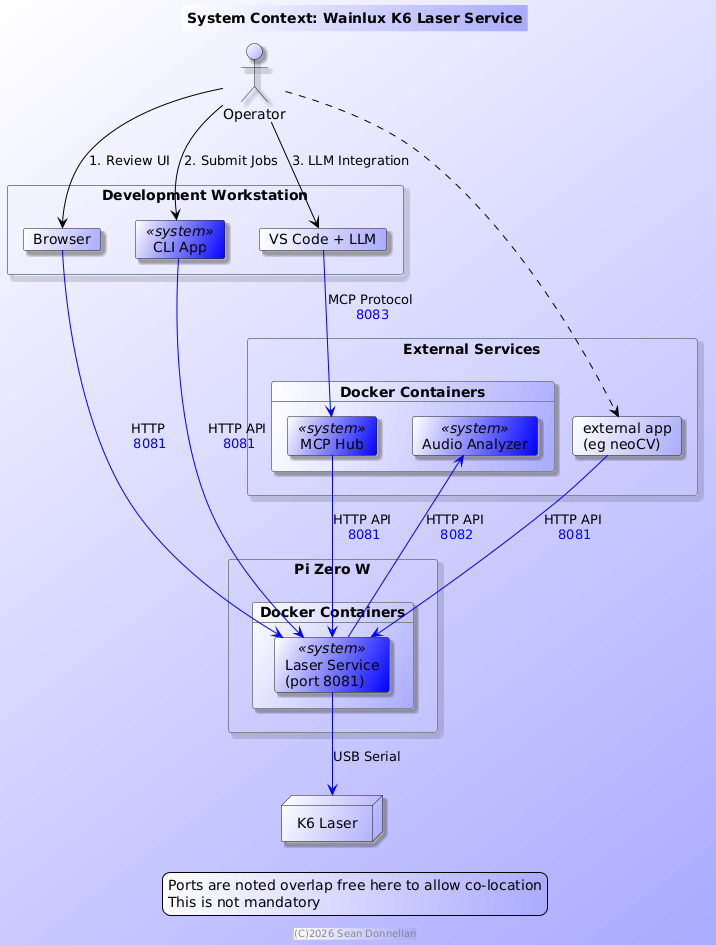
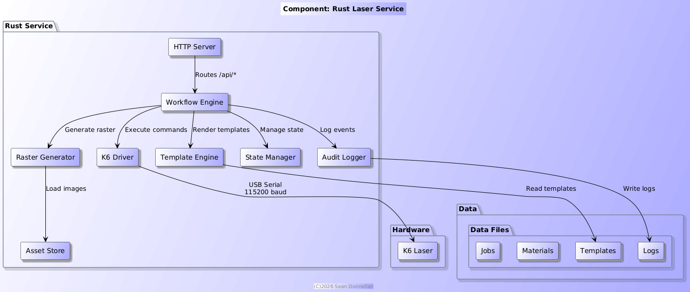
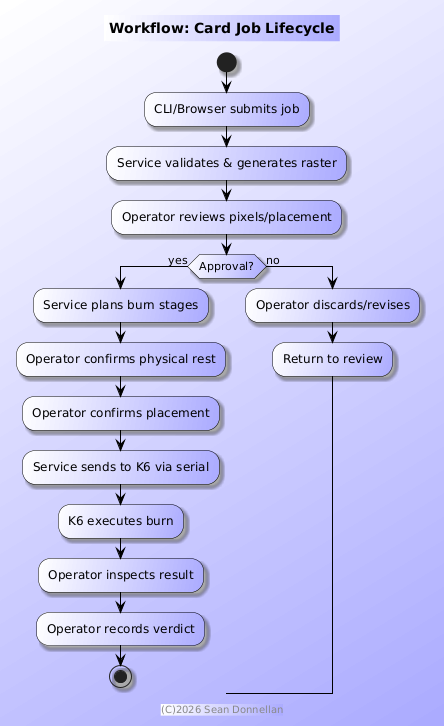
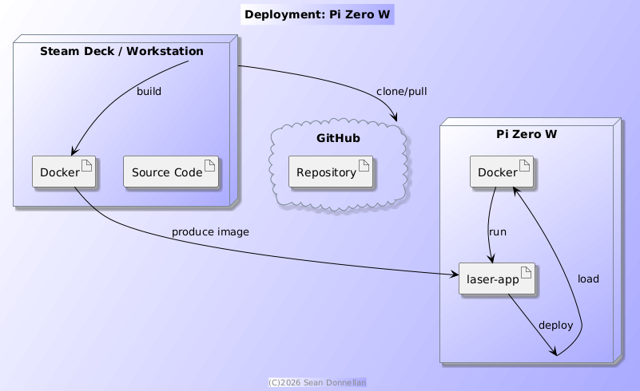
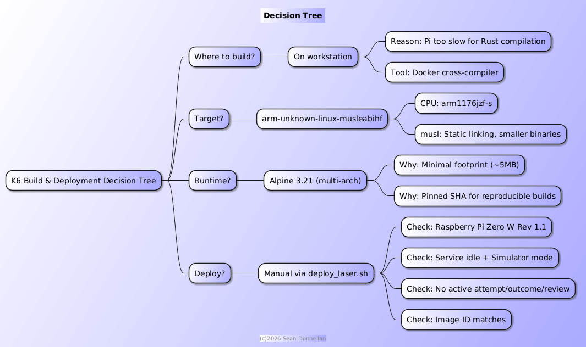

= WAINLUX K6 Web abstraction on Pi Zero W
:single-page:
:docinfo: shared
// Repository configuration - set these base variables to generate all URLs
:repo-org: donnels
:repo-name: wainlux-pi
:repo-file: README
// Derived URLs from base variables
:repo-url: https://github.com/{repo-org}/{repo-name}
:pages-url: https://{repo-org}.github.io/{repo-name}
:html-docs-url: {pages-url}/{repo-file}.html
:pdf-docs-url: {pages-url}/{repo-file}.pdf
ifdef::github-env[]
:icons: font
:tip-caption: :bulb:
:note-caption: :information_source:
:important-caption: :heavy_exclamation_mark:
:caution-caption: :fire:
:warning-caption: :warning:
endif::github-env[]
:imagesdir: ./documentation/images
:localdir: .
include::documentation/includes/include-formatting-book-header.adoc[]

ifdef::github-env[]
.Laser safety symbol
image::../includes/laser-warning.svg[Laser warning symbol,align=center,width=160,pdfwidth=20%]

*Other formats:* icon:html5[] {html-docs-url}[HTML] | icon:file-pdf-o[] {pdf-docs-url}[PDF]
endif::github-env[]
ifndef::github-env[]
include::documentation/includes/include-formatting-content-html-pdf.adoc[]
endif::github-env[]
ifndef::flag-book[]
toc::[]
endif::flag-book[]

== Summary

Source-available host software for personal, non-commercial operation of Wainlux K-series laser engravers using an independently developed protocol implementation. Project-owned material uses one non-commercial, no-AI-training license; see <<project-license>>. These restrictions are not an open-source license.

[NOTE]
====
This project is an independently developed, clean-room implementation created through analysis of publicly observable behavior and legally obtained software.
It is not affiliated with or endorsed by Wainlux.
====

.Is:
* Host-side control software
* Protocol implementation
* Interoperability tool

.*Is not*:
* [line-through]#Firmware replacement#
* [line-through]#Vendor software redistribution#
* [line-through]#Reverse-engineered source release#

The Rust service serves the operator UI and API on port 8081, reviews card jobs, and controls the K6 over USB serial. See <<api-contract>> for the API and <<build-and-test-the-rust-service>> for deployment. The <<cli-client>> only submits Wi-Fi, GitHub recovery and vCard content for operator review; the Pi generates all card rasters.

[[clean-room-statement]]
=== Clean-Room Statement

Project owner and decision authority: Sean Donnellan. Sean triggered and verified the physical K6 tests. Protocol behavior was established from packet captures, serial monitoring, black-box tests and public comparative material. GitHub Copilot performed isolated Ghidra analysis and separately assisted with implementation; only protocol descriptions were handed between those roles. No vendor source, binary, Ghidra project or analysis artifacts are distributed. This was tool-mediated role separation, not a formal two-human clean-room program. See the included <<adr-006-clean-room>> decision for the implementation boundary.

== WARNINGS

[WARNING]
====
* Laser safety: *always* wear appropriate laser safety glasses.
* Fire hazard: do not run unattended; have a fire-safe surface.
** Keep a fire extinguisher handy, or a fire blanket.
* Use a smoke detector.
====

== Stakeholder Requirements

.Stakeholder
* Sean Donnellan
* Anyone else who takes interest

.Goal
* A repeatable laser workflow with an existing machine.

.Problem
* Eyeballing each job, in an iphone app with a tiny screen, is fine for quick work, not for NFC/RFID cards or anything needing accuracy or repeatability.

.Solution
* Invest a few hours. Get it right once. Make NFC engraving reliable and repeatable, even if slow.

.Why
* The laser exists.
* Might as well use it well. 
* Demonstrate capability. 
* Show what's possible across multiple concepts. 
* A small, rounded project.
* A demonstration of what one can create.

.Project status
* [x] Architecture
** [x] Requirements
** [x] Decisions
** [x] Design
* [ ] Features
** [x] Web UI
** [x] API
** [x] MCP
** [ ] Security

== Architecture

The system architecture is documented through the following diagrams:

.System Context

.Component: Rust Laser Service

.Workflow: Card Job Lifecycle

.Deployment: Pi Zero W

.Architecture Decision Tree

For detailed architecture decisions, see <<adr-006-clean-room>> and <<ADR-029-container-security>>.

== Repository Guides

ifdef::github-env[]
* link:{repo-url}/blob/main/documentation/README.adoc[Documentation]
* link:{repo-url}/blob/main/docker/README.adoc[Docker and services]
* link:{repo-url}/blob/main/scripts/README.adoc[Repository scripts]
* link:{repo-url}/blob/main/cli/README.adoc[Card CLI client]
endif::github-env[]

include::documentation/README.adoc[leveloffset=+1]
include::docker/README.adoc[leveloffset=+1]
include::scripts/README.adoc[leveloffset=+1]
include::cli/README.adoc[leveloffset=+1]

[appendix]
== Glossary
include::documentation/includes/include-glossary.adoc[leveloffset=+1]

[appendix]
include::documentation/includes/include-license.adoc[leveloffset=+1]

