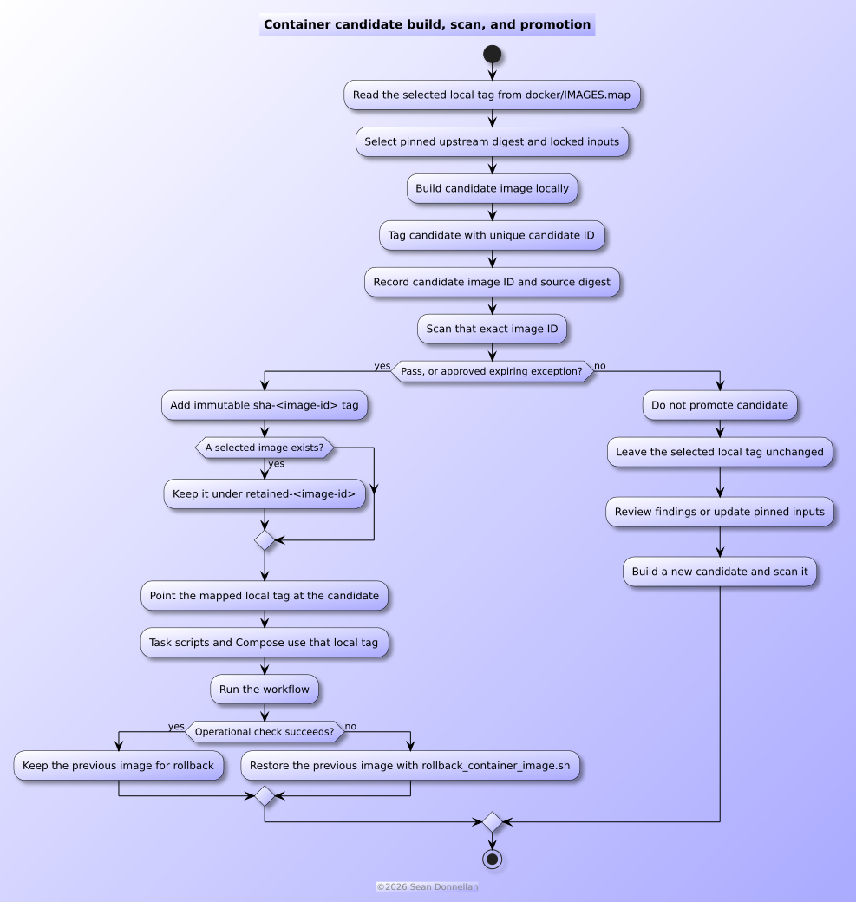

[[pinned-container-images]]
= Pinned Container Images

Every container image is built from a local Dockerfile in this directory. Each external base image uses an immutable digest. The Dockerfiles and lockfiles are the build source; this index makes the pins easy to find and review.

[cols="1,2,2,3",options="header"]
|===
|Container |Purpose |Selected local tag |Pinned base image

|docker-asciidoctor
|Documentation HTML and PDF build
|`localhost/wainlux-asciidoctor:locked`
|`docker.io/asciidoctor/docker-asciidoctor@sha256:1b2d2aa9c04b47bf0b8830d2167331476df72851b0bcee909f7eb2399d24859d`

|docker-plantuml
|PlantUML diagram renderer
|`localhost/wainlux-plantuml:locked`
|`ghcr.io/plantuml/plantuml@sha256:2cf2f097652701319e29b9e6a809e68d4ddb06fbeeb696705c097da8fa6d0507` (official PlantUML CLI, 1.2026.10)

|docker-trivy
|Pinned vulnerability scanner used by build scripts
|`localhost/wainlux-trivy:0.76.2` (scanner trust root)
|`ghcr.io/aquasecurity/trivy@sha256:8f6bb947dbc528902e11f2f5be52f7b519f6a39d5d148f41166f2040499768fb`

|docker-ghidra-mcp
|Isolated local analysis of the ignored vendor JAR; upstream image version 0.3.0 pinned by resolved digest
|`localhost/wainlux-ghidra-mcp:locked`
|`ghcr.io/clearbluejar/pyghidra-mcp@sha256:51e200eeb562e06ea2c509049e4d363d99dbbfb7dff918a80171416b61545e32`

|docker-rust-toolchain
|Native Rust formatter, checker, and test runner
|`localhost/wainlux-rust-toolchain:locked`
|`docker.io/library/rust@sha256:9daf2b244ccc30523e55cafe32edf8465671ba567d0101620e5612ccb76ea1a7`

|docker-wainlux-rs (cross-builder)
|ARMv6 Rust cross-compilation
|Internal Dockerfile build stage; no separate local tag
|`ghcr.io/rust-cross/rust-musl-cross@sha256:90fc4876d17c21346e55dfd4a344924b72c3bb38380749647461cd9595174789`

|docker-wainlux-rs (runtime)
|ARMv6 service runtime
|`localhost/laser-app:arm`
|`docker.io/library/alpine@sha256:bc21487101ae47172509130ee1092cc273a831968d64b617776d1f69c81e42ab`

|docker-audio-analysis
|Audio and run analysis API
|`localhost/wainlux-audio-analysis:local`
|`docker.io/library/python@sha256:a5a7017efc5969e00ae2b91c8eb0631049a569652aa4ffc4501769049ae45c72`

|docker-mcp
|MCP API client
|`localhost/wainlux-mcp:local`
|`docker.io/library/python@sha256:e48f59cdba69a3cbd9ed2cf0f348d90d45a8d350d98134cf1070bc106ee9ed90` (linux/amd64)

|docker-bytefield
|EDN packet renderer; exact npm dependency tree in `package-lock.json`
|`localhost/wainlux-bytefield:locked`
|`docker.io/library/node@sha256:a34ab6d7f6f4813f4d0c5469d74685604b962fbdbf5793a7bc7b4998ecb867c8`
|===

== Candidate Update Flow

Routine scripts use selected local tags. They do not pull, build, or scan images. Image updates use a separate candidate path.

.Build, scan, and promote a candidate

`scripts/update_container_image.sh NAME` builds a uniquely tagged candidate and scans its image ID. Passing candidates receive an immutable `sha-` tag; the prior selected image is retained before the local alias changes. A failed candidate stays available for review and leaves the selected image unchanged. Use `scripts/rollback_container_image.sh NAME TAG` to select a retained version.

HIGH and CRITICAL findings block promotion. `--allow-findings` is a one-run exception for reportable findings. It writes a compact CSV summary and Dockerfile include to the image README. Scanner errors cannot be overridden. See `docker/docker-trivy/README.adoc` for manual CSV reports and `scripts/README.adoc` for command syntax.

== Updating a Pin

Choose a version and its multi-platform manifest digest from the image publisher. Change the Dockerfile and this index in the same commit. Review the base image's platform support and rebuild every dependent image. Do not replace a digest with a mutable tag. Regenerate package locks from their pinned inputs and commit both input and lockfile changes.

`docker/IMAGES.map` is the machine-readable mapping from image name to selected local tag, build context, platform, and any image-specific Trivy exception. Task scripts and Compose use these local tags. `scripts/build_support_containers.sh` and `scripts/build_laser.sh` build selected images without scanning or changing version tags.

The MCP image installs the complete hash-locked dependency set in `docker/docker-mcp/docker/requirements.txt`, generated from `requirements.in` in that directory. Bytefield uses `npm ci` with its checked-in package lock under `docker/docker-bytefield/docker/`. PlantUML uses the official CLI image pinned by digest. Rust uses committed Cargo lockfiles.

Each new candidate image ID is scanned once with the locally wrapped, digest-pinned Trivy image. Rebuilding the same selected image ID reuses its promoted scan; pass `--rescan` to check it against a newer database. The Trivy wrapper is the scanner trust root and is not self-scanned.

Build the Rust toolchain with `scripts/build_local_container.sh rust-toolchain`. `scripts/build_laser.sh` uses the selected Rust toolchain, tests both workspaces, and builds the ARMv6 service to its selected local tag. Use the same local toolchain for direct checks:

.Local Rust check
[source,bash]
----
docker run --rm -v "$PWD:/repo" -w /repo localhost/wainlux-rust-toolchain:locked cargo check --workspace --all-targets --locked --manifest-path docker/docker-wainlux-rs/docker/Cargo.toml
----
