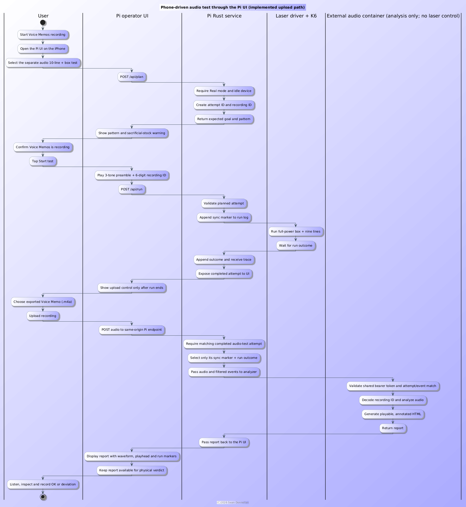
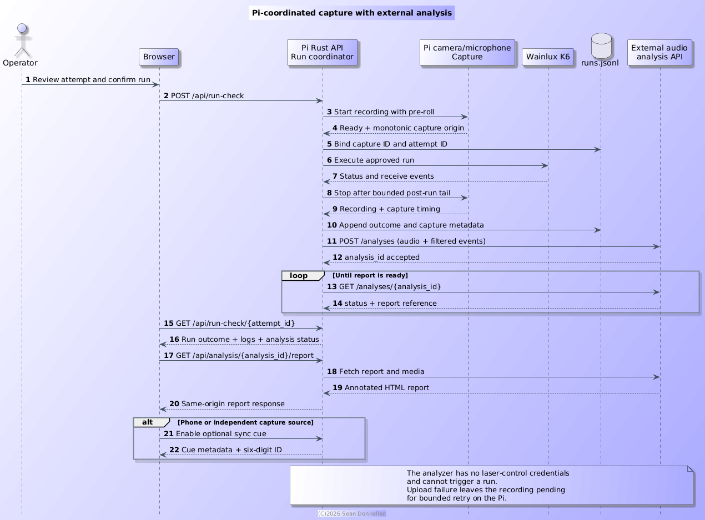

= ADR-028: Pi-Coordinated Capture and External Audio Analysis

== Status
Manual iPhone upload, analyzer pass-through and report proxy are implemented. The LAFVIN audio/display HAT is ordered but not installed or tested; local capture remains pending.

== Context
The Raspberry Pi Zero W owns the laser connection. Its OV5647 camera is available, but no microphone is currently connected. USB audio capture is out of scope because the OTG port is occupied by the laser interface and the extra dongle/cable adds unwanted bulk. Audio decoding and report rendering are separate workloads and should not be added to the constrained laser service process.

== Decision
* The dedicated audio test uses iPhone Voice Memos. The operator confirms recording readiness in the Pi UI before the Pi plays the attempt ID cue and runs the approved test. Future Pi-local HAT capture will instead start before the run and associate audio using a monotonic capture-relative time origin.
* An external analysis service accepts the recording and only the filtered run records needed for correlation. It performs decoding and report generation; it has no laser-control credentials or serial-device access.
* The Pi UI remains the operator's entry point. Any completed Real attempt with an operator-confirmed recording and matching sync marker may be uploaded; the Pi passes only that marker and run event to the analyzer, then proxies the report through the Pi origin. The Pi does not persist the audio or returned report. Upload and analyzer availability do not gate ordinary runs.
* Keep two capture modes permanently: manual iPhone Voice Memos import and Pi-local capture when a supported microphone HAT is installed. Manual upload must not be removed when local capture becomes available.
* The analyzer owns durable audio, filtered run-log events, and HTML reports in its mounted data directory, keyed by attempt ID. It has no automatic restart policy. When it is stopped or not configured, hide the audio-only test and report controls; ordinary Pi laser operation and the existing power sweep remain available. If an upload never reaches the analyzer, the original remains in Voice Memos for retry or local-CLI use.
* A human explicitly confirms the stock, plans, and starts every physical run in the Pi UI. MCP and analysis tools are read-only and cannot fire the laser or apply parameters.
* Keep the audible sync cue as an optional mode for phone or other independently started recordings. Do not make the audio analyzer a run trigger.
* The selected HAT candidate is the [LAFVIN Audio Display HAT](https://lafvintech.com/products/lafvin-audio-display-hat-for-raspberry-pi-with-1-69-inch-color-display-screen-audio-display-expansion-board). Its published specifications list dual MEMS microphones, a WM8960 codec, an 8-ohm/1-watt speaker, RGB LED, one physical button, and a 1.69-inch 240x280 ST7789 SPI display. The display is non-touch and is suitable for concise status and warning states, not as a replacement for the browser operator UI.
* Do not treat the HAT as compatible with the current original Pi Zero W. LAFVIN's [user guide](https://lafvin-audio-display-hat.readthedocs.io/en/latest/about_this_kit.html#compatibility-and-requirements) lists Zero 2 W, Pi 3 B+, Pi 4 and Pi 5, recommends 64-bit Raspberry Pi OS, and does not list Zero W. Verify the exact board revision, ARMv6/32-bit support, GPIO/SPI use, power draw, drivers and service changes before installation. Do not run the vendor installer on the laser Pi as a probe.

== Data Flow
For any Real run, the operator may start Voice Memos and check the optional recording confirmation before starting. The Pi then plays the attempt ID cue. Without that checkbox, ordinary run behavior is unchanged. The two dedicated audio profiles use the same 20 mm box plus nine 19 mm lines, each at one fixed power: minimum nonzero power (currently 1/1000, nominally no-mark but not guaranteed) and full power (1000/1000, marking expected). These remain separate analyzer-gated manual runs with no automatic transition. After a marked run completes, its iPhone `.m4a` can be uploaded when the analyzer is available. The analyzer stores the source media, filtered events, and report on its own volume. The Pi proxies the report without retaining audio or report copies.

.Implemented phone-driven test and upload pass-through

.Future Pi-local HAT capture

The Pi upload route accepts a completed Real attempt with its matching sync marker. It accepts a raw recording up to 64 MiB and forwards only the matching marker and run event to the configured analyzer. The analyzer URL and bearer token are server-side configuration; neither is exposed to the browser. The report provides recording playback, sync matching, filtered run-log events and measured processing timings only; it does not classify sound activity or infer physical state. The human physical verdict remains authoritative.

== Initial Camera Feasibility Check
On 2026-11-11, an initial read-only check of the Pi Zero W Rev 1.1 on Raspberry Pi OS 13 (kernel `6.18.60+rpt-rpi-v6`) found `/dev/video*` and `/dev/media*` nodes and the `rpicam-hello` and `v4l2-ctl` utilities. The SSH user belongs to the `video` group, but the first `rpicam-hello --list-cameras` call reported `No cameras available!` and `vcgencmd get_camera` reported `supported=0 detected=0`. No image was captured during that first check.

A later check on the same day enumerated an OV5647 (`/base/soc/i2c0mux/i2c@1/ov5647@36`) with modes up to 2592x1944. `rpicam-still --nopreview --timeout 1000` successfully captured a 2592x1944 JPEG (about 1.2 MB). The image was visually inspected. This confirms Pi-local still capture is available; video and microphone capture, sustained capture load, and synchronization with a run remain untested. No laser job was started and no software was installed.

== Consequences
* The Pi is a bounded transient pass-through; the analyzer volume is the only durable home of the source audio, filtered run events and report.
* The analyzer has no automatic restart policy. Stopping it releases CPU/RAM but preserves its volume; while it is unavailable, the audio test and report UI are hidden and ordinary laser operation continues.
* The original iPhone recording remains available in Voice Memos until the analyzer accepts and persists it. The local-file CLI is an independent fallback.
* The Pi UI's confirmation and explicit run action remain the sole laser-start authority. The MCP and analysis services provide evidence/suggestions only, not run or settings mutations.
* Keep both the unauthenticated Pi API and authenticated analyzer on a trusted network; firewall the analyzer port to the Pi.
* No end-detection policy or automatic job progression changes as part of this decision.

== Measured Upload Sizing
The real frame sample embedded in the UI report originated as an 836,997-byte M4A for 50.154667 seconds, about 16,688 bytes/second (133.5 kbit/s). A successful Wi-Fi card content run lasted 2,054 seconds. Adding the sample's approximately 36.2 seconds of pre/post-run audio estimates 34.9 MB (33.3 MiB). A 16 MiB limit covers only about 1,005 seconds; the matching 64 MiB cap gives about 1.9x headroom. Actual Voice Memos bitrate and duration may vary. The verification working folder has been removed; the self-contained HTML demo preserves playback and annotations.

== MCP and Future Analysis
The Pi MCP hub is intended as a read-only discovery/query path for attempts, run logs, operator comments/verdicts, analyzer metadata/reports, and eventually Pi-camera stills. Audio is one independent tool among future camera and pattern-analysis tools. An LLM may compare evidence or suggest end-detection/material experiments, but must not fire the laser or silently apply settings. Human review and the explicit Pi UI plan/run flow remain authoritative. Camera scanability analysis is future work.

== HAT Follow-Up
Before enabling HAT capture, resolve the original Zero W compatibility gap or move the laser service to a supported Pi. Test microphone capture, audio/display load, RAM/CPU, 5 V power, speaker, and warning/status UI. The HAT button must not add another laser-start or authorization path.

== Alternatives
* Keep iPhone Voice Memos as a permanent manual capture mode even after HAT capture is available.
* Keep decoding/report work off the Pi so the analyzer can be stopped when not needed.
* Do not expose a laser-start operation through MCP or the analyzer.

== Related
See <<adr-027-audio-end-detection,ADR-027>> for evidence policy and <<fr-017-end-detection,FR-017>> for acceptance criteria.