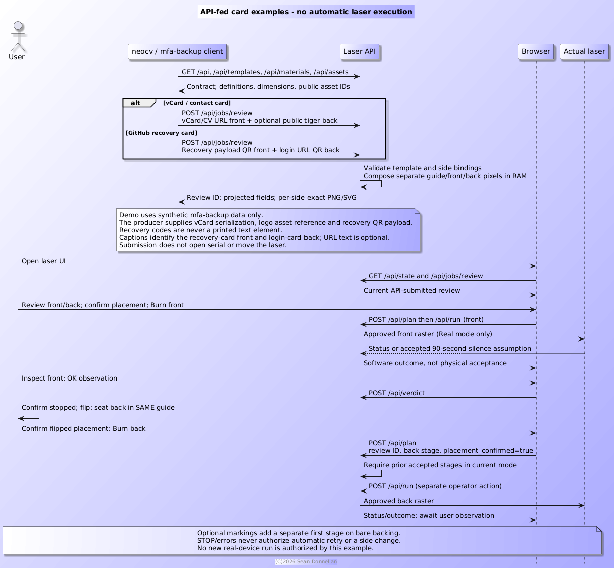

= FR-016: Reviewed Card Jobs

== Status
Implemented for WiFi, vCard and GitHub recovery templates; integration and physical acceptance remain use-case dependent.

== Requirement
Accept a typed card job, compose and return separate reviewed stages, and require explicit operator action for each physical stage.

== Acceptance

* Supported templates are supplied by TOML definitions; API clients may submit typed content or edit declared fields.
* Review returns side-specific raster pixels, dimensions, layout and display policy without opening the serial device.
* Front and back are separate stages. A back stage requires an accepted preceding stage and explicit flip/placement confirmation.
* Only separate plan and run requests execute a stage. Software outcome and operator verdict remain distinct.
* Private job/review data stays in process memory and is omitted from operational logs; restart loses the review.

== Trust Limit

The producer submission and machine APIs are unauthenticated and intended for a trusted LAN. There is no per-client ownership, lease or producer/operator authorization. Masking is a UI convenience, not access control. Do not expose this service publicly.

.Current API submission, review, and operator-controlled run sequence

