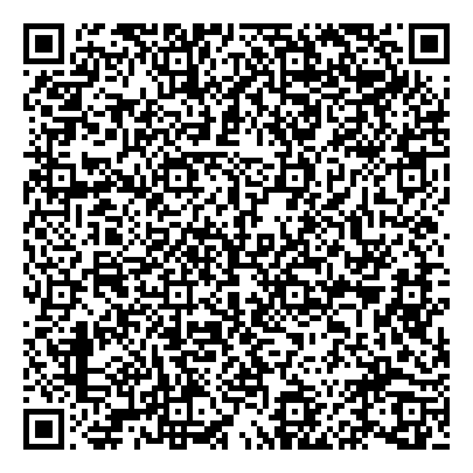
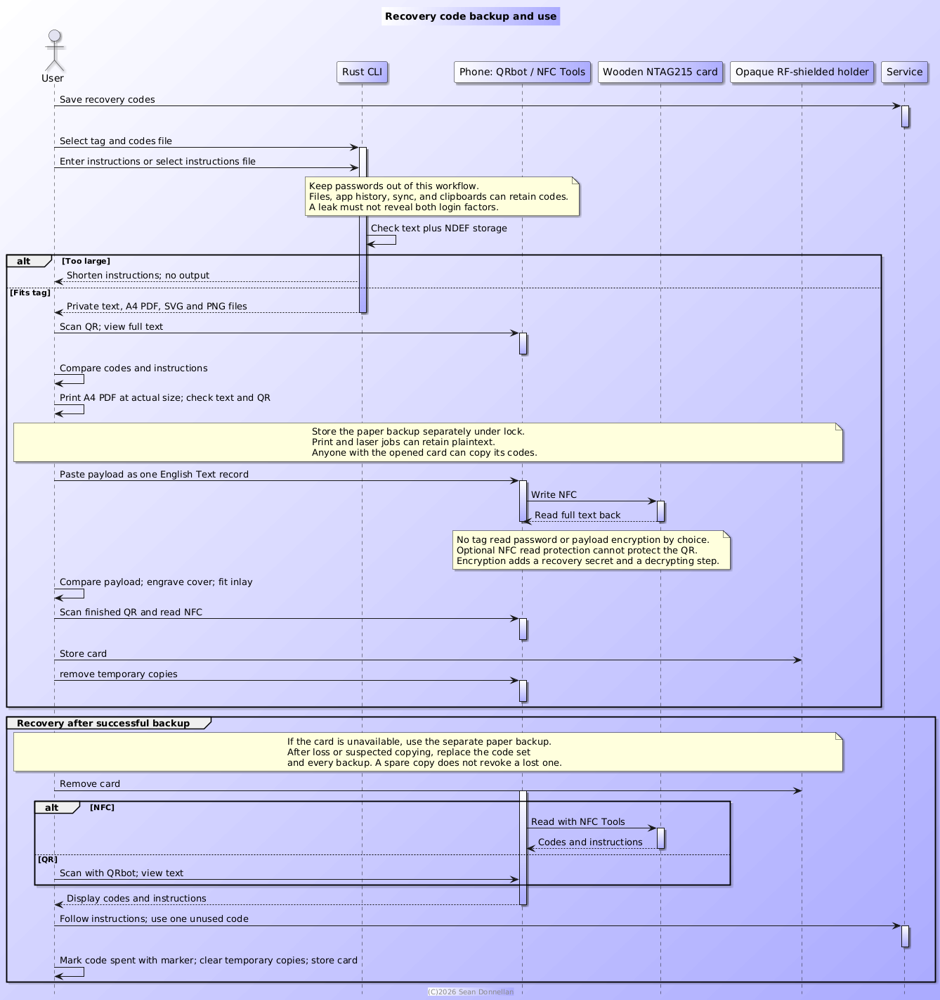

= Recovery Code Backup
:author: Sean Donnellan
ifndef::flag-book[]
:toc: right
:sectnums:
endif::flag-book[]

Keep recovery codes and short instructions in one text payload.
Put that payload in a QR and a wooden NFC card.
Recover it to a phone when you need a code.
No server. No HTML. No Base64. No encryption.

[WARNING]
====
include::LICENSE.txt[]
====

== Files

* link:cli/Cargo.toml[Rust CLI] and link:cli/src/main.rs[source].
* link:docs/rust-guide.adoc[Beginner's Rust reading guide].
* link:examples/recovery-instructions.txt[Instruction template].
* link:examples/synthetic-codes.txt[Synthetic demo codes] and link:examples/demo-qr.png[demo QR].
* link:docs/workflow.plantuml[Workflow source] and link:docs/workflow.png[image].
* `private/` holds the original codes. Remove them when you are ready.

== Try The Demo

Start with the synthetic codes, not a private file.
They identify a fictional account and cannot unlock GitHub.
The demo uses the same instruction template and CLI as a real backup.

Run from this folder:

.Generate a demo from synthetic recovery codes
[source,shell]
----
mkdir -p output
cargo run --release --manifest-path cli/Cargo.toml -- \
	--tag ntag215 examples/synthetic-codes.txt \
	--instructions examples/recovery-instructions.txt \
	--output output/demo
----

This writes demo text, an A4 PDF, an SVG, and a PNG under `output/`.
If those files already exist, use another output prefix.
Scan the retained example below with QRbot and open its text view.
It contains the instructions and synthetic codes, not a website link.
Use the demo to test phone reading, paper printing, or NFC writing before using real codes.

.Synthetic recovery-code QR containing fictional demo values

The image is kept as documentation. If you change the demo inputs, regenerate it
with the command above and replace `examples/demo-qr.png` with the generated PNG.

[WARNING]
====
Never replace this synthetic example with a real-code QR.
====

== Create

Run these commands from this folder. Rust and Cargo are needed to build.
The built CLI does not need a container or network connection.

.Build the CLI and prepare an output directory
[source,shell]
----
cargo build --release --manifest-path cli/Cargo.toml
mkdir -p output
----

Read codes from a file. Enter the service, account context, and instructions.
KISS choice: line-by-line feedback, not a live typing counter.
The prompt shows UTF-8 bytes left after the codes, separators, and NDEF overhead.
Press Enter to submit each line. Ctrl-D on an empty line finishes.
Ctrl-C during the prompt cancels without writing outputs.

At exact capacity, input ends automatically. An oversized line is rejected whole;
accepted lines stay intact. Retry with a shorter line or finish with Ctrl-D.
To change an earlier line, cancel and start again.
The CLI shows the final byte count before generating files.

.Generate a backup from a private codes file
[source,shell]
----
cli/target/release/mfa-backup --tag ntag215 private/github-recovery-codes.txt --output output/backup
----

Or edit the instruction template and use it:

.Generate a backup with the instruction template
[source,shell]
----
cli/target/release/mfa-backup --tag ntag215 private/github-recovery-codes.txt --instructions examples/recovery-instructions.txt --output output/backup
----

File input is checked as a whole. An oversized payload fails with a nonzero exit
status and no output files. Empty instructions also fail.

[WARNING]
====
Do not put passwords in the instructions. It's just not good practice and you have been warned. In the end though it's possible and your choice and not mine.
====

Include enough account context to identify the right login.

The CLI saves the combined text as `output/backup.txt` and the same QR as
`output/backup.svg` and `output/backup.png`. It also writes `output/backup.pdf`:
one A4 page with a 100 mm vector
QR above the full readable text. Print the PDF at actual size (100%).
Instructions come first. Codes follow unchanged except for
leading and trailing whitespace. Existing outputs are not overwritten.
On Unix, outputs are owner-readable and owner-writable only.
Keep inputs private too. Do not commit codes or generated files.

Test with synthetic codes before using the real file.
Use a different output prefix for each run. Remove interim outputs when done.

== Capacity

[format=csv,options=header,cols="1,1,1"]
|===
Tag,User memory (bytes),Maximum text (UTF-8 bytes)
NTAG213,144,134
NTAG215,504,489
NTAG216,888,873
|===

The CLI counts UTF-8 bytes, one English NDEF Text record, and Type 2 TLV overhead.
Maximum text includes codes, instructions, and separators under this layout.
Use one Text record with language `en`. Add no other records.
NFC Tools may use a different layout. Its write check and a read-back are final.
Shorten instructions if the payload does not fit. Do not drop codes.

== Make The Card

. Scan the QR on screen with QRbot. Open its text view, not a detected link.
. Compare all codes and instructions with the source. (Do not spend a code to test it unless you want to test the codes too).
. Transfer the PNG and text to the phone through a trusted channel if needed.
. Print the A4 PDF at actual size. Check its QR and readable text.
. Keep that paper backup in a secure place separate from the NFC card.
. In NFC Tools, choose Write, Add a record, Text. Paste the whole payload. Use language `en`.
. Write one record to the NTAG215. Read it back and compare the full text.
. Test engraving on scrap. Use strong contrast and keep the QR border.
. Engrave the wooden cover before fitting the NFC inlay. Do not laser the antenna or chip. Engrave, or rather lightly etch, don't nuke.
. Scan the finished QR and read the assembled NFC card again.
. Store the card in an opaque, RF-shielded, credit-card-size holder. Check that NFC cannot be read while enclosed.

PDF is for paper printing. SVG is for laser software. PNG is for phone transfer.
The images use the same QR matrix and medium error correction.
The PDF embeds DejaVu Sans Mono. Its license is in `cli/assets/ttf-dejavu`.
Text wraps without splitting codes. If it cannot fit at 8 points or larger,
the CLI rejects it rather than clipping text or adding a page.
Set the SVG's physical size in the laser tool. Allow room for the border within
the card's roughly 86 by 54 mm face. Test the chosen size before engraving.
Wood grain, surface finish, contrast, and module size affect scanning.

== Recover

Remove the card from its holder.
Read its NFC Text record with NFC Tools, or scan its QR with QRbot.
Display or copy the codes and instructions. Follow the service's recovery steps.
Stock iPhone Camera and background NFC reading may not display plain text.
The reader apps are required for this workflow. Reading works offline.

== Protect

Anyone who reads the QR or NFC can read the codes.
An opaque holder hides the QR. RF shielding limits NFC access; it is not encryption.
Neither wood nor the holder makes the backup waterproof or indestructible.
Test the holder rather than trusting its label.

=== Theft And Password Separation

Treat the card and printed PDF as secrets. Store them under lock, not in an everyday
wallet. A thief can photograph the QR or copy the NFC record without leaving a mark.
The holder does not protect the contents after it is opened.

Keep the login password in a secure password manager, separate from these backups.
Do not include it in the input, instructions, QR, NFC, or PDF.
For GitHub's password-and-recovery-code flow, a leaked code set alone does not
provide the password. Storing both together can give a thief both login factors.
Separation reduces that risk; it does not make stolen codes harmless.
For some services a recovery code alone is enough. Check the service's rules.
The CLI cannot detect a password mistakenly included in an input file.

=== Workflow Leaks

Every plaintext step can leave a copy: downloaded codes, generated files, phone
Photos and cloud sync, QRbot history, NFC Tools records, the clipboard, print queues,
and laser job files. The apps and devices must be trusted. Offline use alone does
not prove that they will never retain or upload data.
Use a trusted local printer and laser. Do not send real jobs to a shop.
Check app retention and sync settings. Remove temporary files, scan history,
clipboard contents, and job copies when done. Deletion is not secure erasure.

These leak points are another reason to keep passwords out of this workflow.
A copied print job or scan should not disclose both the password and recovery codes.

=== Loss And The Paper Backup

Keep the printed A4 PDF in a separately secured location, not in the card holder.
Its QR and readable text provide another way back in if the card is lost, damaged,
or unreadable. The text also works without an NFC or QR reader.
The PDF file alone is not an offline paper backup. Print it and protect the copy.
An extra copy improves availability but creates another secret to secure.

If the card, paper backup, or a digital copy is lost, stolen, or possibly copied,
use the remaining recovery method to secure the account. Generate a new code set
promptly and replace every backup, including the paper copy and engraved QR.
Do not wait for proof of misuse. The remaining backup restores access; it does not
revoke the lost one. Keep a spare authentication method too.

Track spent codes separately. When you replace the code set, rewrite NFC and replace
the engraved QR or the card. A rewritten tag does not update an old engraving.
Marking a spent code on paper does not update NFC or the QR.

=== Optional Access Protection And Encryption

This personal backup is not a military installation. I deliberately leave the
card without a read password or PIN-style gate to keep recovery simple.
That is a trade-off: I rely on physical custody to protect the backup.

NTAG215 supports optional 32-bit password access protection. One could configure
read protection and a compatible reader, but the CLI does not do so.
Write-only protection would not stop someone reading the codes.
This tag password is not CAC-grade PIN protection or payload encryption.
It adds another secret to preserve and cannot protect the engraved QR or paper text.

An NFC-only variant could omit the engraved QR and readable codes from the card.
Then tag read protection could gate the remaining on-card route. Keep the separate
paper backup secure. NFC-only storage without read protection is still readable.

Payload encryption could also be added. Encrypt before encoding both NFC and QR,
and use a local decrypting reader on the phone. Protect or omit any printed plaintext
as well; encrypting the QR does not protect readable codes beside it.
Encryption raises the theft barrier, but adds a key or passphrase, a decrypting step,
and tag-space overhead. The encrypted payload may not fit NTAG215.
Losing the decryption secret can make recovery impossible.

I have not implemented encryption. For this personal-use design, I chose a separate
password, locked custody, and a separate paper backup instead of another recovery
secret. A higher-risk account may justify encryption and a more involved workflow.

== Security Review

Reviewed against public guidance.
This is a personal offline backup, not a certified authenticator or a hollow metal military system under the Atlantic with missile codes.

https://pages.nist.gov/800-63-4/sp800-63b.html[NIST SP 800-63B-4], section 4.2.1.1,
allows saved recovery codes in QR form. It says to keep them offline and store them
securely. The chosen format fits that advice. Safe custody still depends on the owner.
NIST's server-side hashing rules are for the service's verifier. Hashing the backup
would make the original codes unrecoverable; it is not a backup protection method.

https://docs.github.com/en/authentication/securing-your-account-with-two-factor-authentication-2fa/configuring-two-factor-authentication-recovery-methods[GitHub's recovery guidance]
supports printed copies, recommends a secure password manager, and warns against
sharing codes. It recommends two or more authentication methods. Keep a spare
security key or another supported method separate from the primary phone.

https://www.cac.mil/Common-Access-Card/Managing-Your-CAC/[DoD CAC guidance]
protects the PIN and requires revocation of lost or compromised cards.
A CAC gates access with a PIN and locks after failed attempts.
The QR and plain NFC record have no such gate. NTAG215 is not a CAC replacement.
I do not claim DoD, FIPS, or NIST assurance-level compliance.

=== Local Files

[TIP]
====
Digital copies: inputs and outputs are plaintext. Unix permissions do not protect against the file owner, administrators, malware, backups, or theft of an unlocked device. Use encrypted storage and trusted, updated devices. Keep unnecessary copies out of Photos, cloud sync, shared folders, email, and chat. The choice is yours.

Local permissions: the source is now in `private/` with directory mode `0700`and file mode `0600`. Generated backups use `0600` on Unix.Keep those restrictions when replacing files. Permissions do not encrypt files.
====

Run from this folder on Unix:

.Restrict permissions on private inputs
[source,shell]
----
chmod 700 private
chmod 600 private/github-recovery-codes.txt
----

[WARNING]
====
Suitable only as a physically secured personal backup with controlled
processing and prompt replacement after loss. It is not theft-resistant storage.
Source permissions, device encryption, app retention, holder shielding, and physical
custody are not all enforced or verified by this tool. It is your choice to use or not use it.
====

== Workflow

.Backup creation, card writing, and recovery workflow

Edit link:docs/workflow.plantuml[the PlantUML source] and render it locally.
Do not send real codes to a public diagram server.

== Glossary

include::docs/glossary.adoc[]